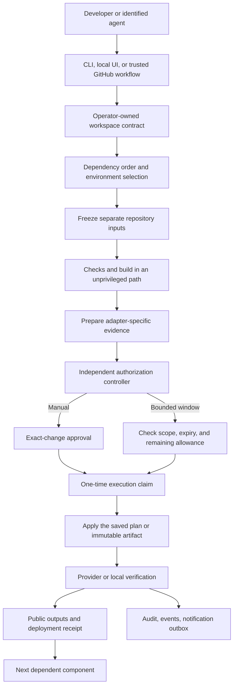
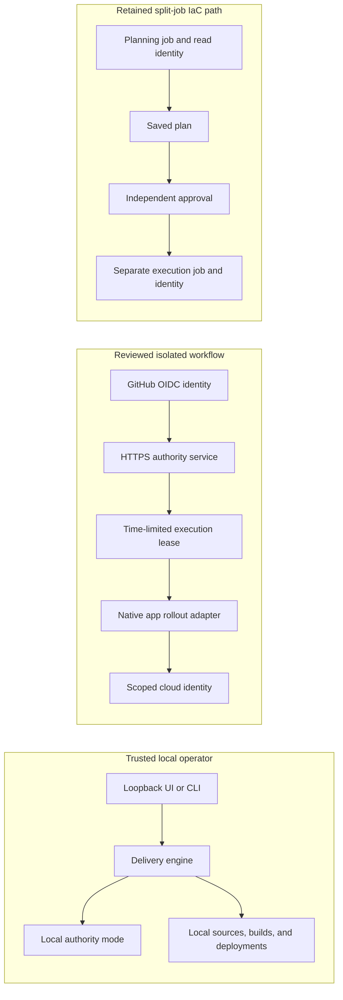
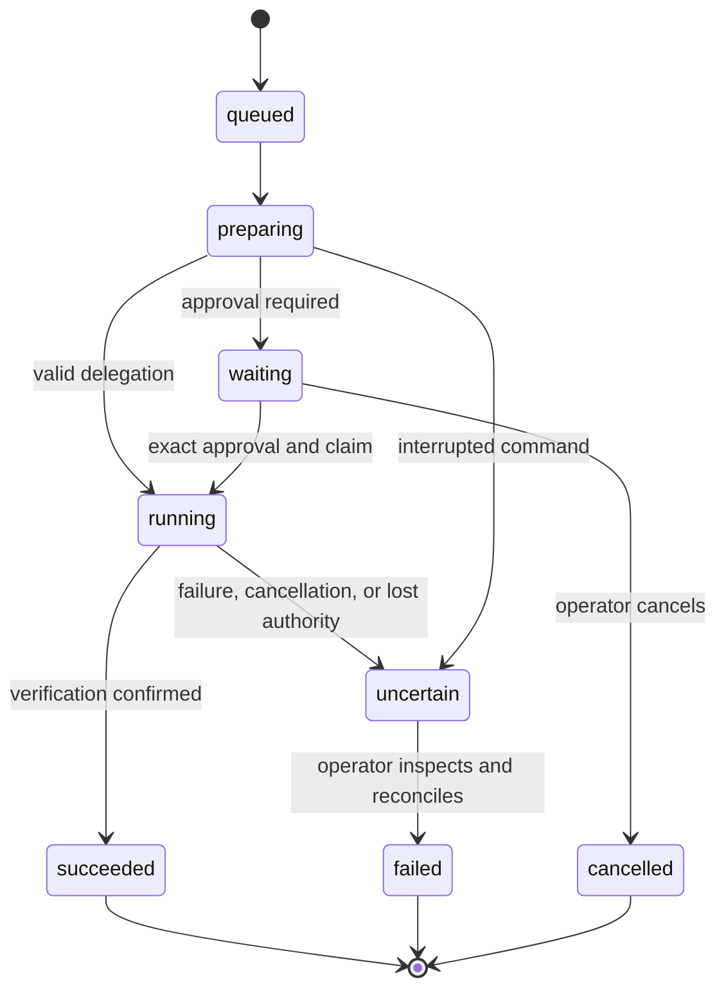

# Architecture

## One deployment model

A workspace joins repositories, environments, components, and dependency outputs. A release freezes source revisions and configuration. Each component prepares evidence, requests authority, executes an exact reviewed artifact, verifies the result, and records public outputs.

## Owned code and external tools

`delivery/spec.py` owns the configuration contract, `delivery/engine.py` release state and dependency coordination, and `delivery/adapters/` tool-specific preparation and execution. `service.py`, `policy.py`, and `identity.py` own authorization, and `store.py` provides transactions and the audit chain. The CLI and console call the same operations. No approval or deployment logic is copied into JavaScript.

## Current execution boundaries

The local operator identity is labeled `local`, never a verified GitHub identity. A local token controls the trusted local workspace and isn't a multi-user boundary.

The remote delivery worker doesn't run repository build hooks, generic workflows, or IaC, because its GitHub job could mint writer credentials while untrusted code runs. The OpenTofu worker can issue typed AWS ECS output receipts. A separate app worker binds their digests into its approval, and the controller rechecks them at submission, claim, heartbeat, and completion. A later infrastructure claim permanently invalidates earlier receipts. See [infrastructure receipts](infrastructure-receipts.md).

## State and interruption

SQLite records release progress, requests, claims, delegation use, outputs, audit links, and the notification outbox. Use one service process on local durable storage. Network filesystems and multi-replica scheduling aren't supported, and a stale execution lock is never cleared automatically.

An output receipt proves what DeployOps recorded, not that live infrastructure is unchanged. App-only runs reuse the last matching receipt and skip infrastructure discovery and drift reconciliation.
