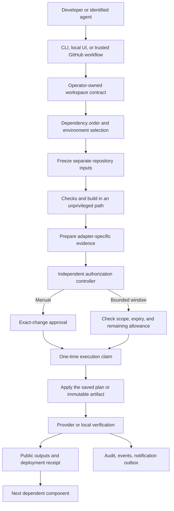
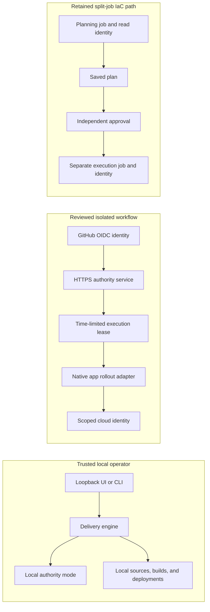
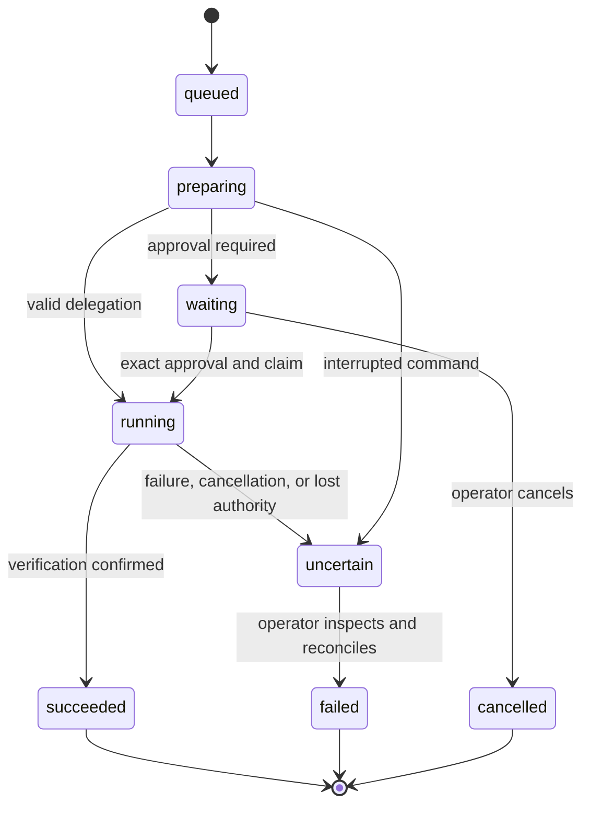

# Architecture

## One deployment model

A workspace joins repositories, environments, components, and dependency outputs. A release freezes its
source revisions and configuration. Each component prepares evidence, requests authority, executes an exact
reviewed artifact, verifies the result, and records public outputs.

## Owned code and external tools

`delivery/spec.py` owns the configuration contract. `delivery/engine.py` owns release state and dependency
coordination. `delivery/adapters/` owns tool-specific preparation and execution. `service.py`, `policy.py`,
and `identity.py` own authorization. `store.py` provides transactions and the audit chain. The CLI and console
call the same operations. No approval or deployment logic is copied into JavaScript.

External tools perform their own specialized work. Terraform/OpenTofu manage their provider graph and
state. Docker builds and runs containers. AWS, Azure, GCP, and Kubernetes retain their own rollout semantics.
DeployOps does not emulate clouds or claim one provider switch can translate an application's architecture.

## Current execution boundaries

The local operator identity is labelled `local`, never represented as verified GitHub identity.
A local token grants control of the trusted local workspace. It is not a multi-user security boundary.

The remote delivery worker does not execute repository-defined build hooks, generic workflows, or IaC.
Its GitHub job could otherwise mint writer credentials while untrusted preparation code runs.
Cross-repository cloud orchestration must compose separate workers and durable receipts. That is an explicit
next phase, not a hidden claim that the current local scheduler already supplies it.

## State and interruption

SQLite records release progress, requests, claims, delegation use, outputs, audit links, and the notification
outbox. Use one service process on local durable storage. Network filesystems and multi-replica scheduling
are not supported. A stale execution lock is deliberately not cleared automatically.

An output receipt proves what DeployOps recorded, not that the live infrastructure remains unchanged.
Application-only runs intentionally reuse the last successful matching-contract receipt. They do not run
infrastructure discovery or drift reconciliation. Review that receipt or deploy infrastructure again when needed.
