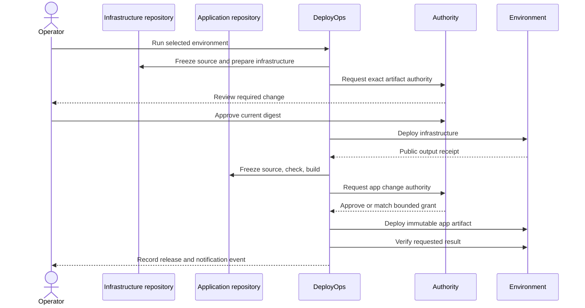

# Workflows

## Separate infrastructure and application delivery



This sequence runs locally. The cloud IaC path uses the separate gate workflow. Never combine cloud planning, arbitrary source builds, and writer credentials in one job.

## Review and delegation

`deploy-ops run development` pauses at an exact request. Approve its digest, then resume. A changed artifact, source snapshot, target policy, or workspace can't reuse that approval.

```bash
deploy-ops delegate development --hours 2 --uses 2
deploy-ops run development
```

Each component gets its own allowance. By default only known nonproduction local directory and static changes qualify, and unknown operations still wait. Use the gate's operator command for remote grants. There is no global approve-everything mode.

## Promote and roll back

```bash
deploy-ops run staging --component foundation
# Approve and resume that infrastructure release first.
deploy-ops promote SOURCE_RELEASE_ID staging --component web
# Review the staging request, then approve and resume it.
```

`promote_from` defines allowed environment transitions. Promotion reuses the source release's successful artifact and records its origin. The workspace contract must still match, and the destination's dependency receipt must exist. Infrastructure is never cloned across clouds.

To restore a previously successful artifact in the same environment:

```bash
deploy-ops rollback PREVIOUS_RELEASE_ID development --component web
```

Rollback creates a new reviewed release. It isn't an inverse infrastructure plan or a database restore, so schema migrations and external side effects need their own recovery plan.

## Interrupted work

Cancel a waiting release with `deploy-ops cancel RELEASE_ID`. Cancelling a running command requests termination, but provider activity may continue, so the target stays uncertain and blocked. Stop the worker, inspect the target, and reconcile:

```bash
deploy-ops recover RELEASE_ID --note "Inspected the target. Recorded the provider revision and confirmed its state."
```

Don't reuse that sentence without inspecting the target. Start a fresh release afterward. The tool never assumes a failed command had no effects. If controller inspection already resolved the request as failed while delivery still shows waiting, cancel the release to close that record. Cancellation keeps the controller's final decision.

The console's release inspector and `deploy-ops events RELEASE_ID` show command outcomes in execution order: tool, component, local exit code when known, and elapsed milliseconds. An interrupted command has no confirmed exit code, so inspect its target before retrying. `not-started` means the local process couldn't launch. Older records show duration unavailable. None of these establish provider health or rollback.

For Container Apps, `deploy-ops provider inspect RELEASE_ID COMPONENT` reads the exact app and revision recorded before its update and checks the immutable image, container, template hash, health, and Single-mode activation without replaying the update. A missing or unreadable revision stays unknown, and readback doesn't clear release uncertainty. Same-image delivery makes no update call and verifies the existing revision. Missing evidence for a nondefault setting is refused ([scaling defaults](https://learn.microsoft.com/en-us/azure/container-apps/scale-app), [ephemeral storage](https://learn.microsoft.com/en-us/azure/container-apps/storage-mounts)).

The adapter uses a release-specific revision suffix, but that isn't idempotency, and the read and write aren't atomic, so a concurrent external change can race the update. DeployOps never repeats the update after recording an attempt. Recovery and no-op behavior have fixture coverage only.

## Command output failures

Local delivery commands share a 10 MB raw-byte budget across stdout and private diagnostics, checked while a child runs and after it exits. Exit code zero can still be an unusable result when output exceeds the budget. Inspect the recorded outcome and the target before retrying, because the command may already have changed files or a provider. There is no automatic replay or rollback. Private diagnostics stay out of ordinary events, displayed stdout is redacted before its tail is chosen, and the limit reserves no disk capacity.

## Notify and page

Entering approval wait records one event with the component, request ID, and digest. Repeated waits or resumes of the same pending request create no new event or notification, and a new pending request gets its own. If cancellation settles while a waiting CLI sleeps, the waiter reports it without executing. Resuming a terminal release is refused.

Events are saved before delivery. Send the outbox from a trusted scheduled worker or after a run:

```bash
export DEPLOY_OPS_NOTIFY_URL='https://your-approved-receiver.example/events'
deploy-ops notify
```

Use `--kind slack` for an incoming Slack webhook or `--kind ntfy` for a topic endpoint. JSON webhooks can be signed with `DEPLOY_OPS_NOTIFY_SECRET`, and `DEPLOY_OPS_NOTIFY_TOKEN` adds receiver authentication. Receivers should deduplicate `Idempotency-Key`. Delivery is at least once, up to ten attempts, retried on another flush. Payloads hold release IDs and event names, not source, tokens, or plans. Paging and on-call schedules belong to an external system.

## Observe local drift

```bash
deploy-ops observe RELEASE_ID
```

The console offers **Inspect deployed files** in release detail. The result has observation time, findings, and expected and observed digests, and records an audit event without changing files, approvals, or the release outcome. Static observations compare retained files with the current activation pointer. A later activation shows as `superseded`, and older corruption still reports `drifted`. Directory observations compare only `resource.json`.

| Result | Meaning |
|---|---|
| `matching` | The inspected files matched at that time |
| `drifted` | Recorded data is missing or different |
| `unknown` | Evidence is unreadable, unsafe, changing, or blocked by unresolved local execution |
| `unsupported` | Other adapters |

Out of scope: file permissions, empty-directory changes, application health, cloud state, and container runtimes. Nothing is repaired automatically. Inspect a drifted or unknown target, then prepare a new exact change. A matching observation isn't a snapshot or protection against a malicious process running as the same OS user.

## Temporary private cache outcomes

Each component can keep a `private_cache_cleanup` observation for its runtime `home` and `build-home`, shown by `deploy-ops status RELEASE_ID`, the release API, or the console's **Temporary private cache cleanup** disclosure. A warning appears only for unverified or failed cleanup or recording. It is separate from the deployment result and never a reason to replay deployment.

| Outcome | Meaning |
|---|---|
| `removed` | The private directory was removed and its location checked absent |
| `absent` | It was absent at inspection |
| `failed` | Native removal failed |
| `unverified` | Supported ownership, path, or removal evidence was unavailable |

The observation covers only those operation-owned homes, never source, artifacts, application data, grants, or credentials, and holds no cache contents, sensitive paths, or raw exceptions. It is published as pending before the cache is used, so a failed final recording can't leave an older clean observation looking current.

Inspect a warning through the original local operator after checking that the operation's worker has stopped. There is no cleanup retry, janitor, permission override, replay, credential rotation, or rollback. Unrecorded or replaced runtime-home entries refuse use without permission repair, so preserve them for the original operator.

Removal uses no-follow directory descriptors and symlink-resistant removal, and unsupported platforms report `unverified` instead. It doesn't prove secure erasure, memory clearing, or token revocation, and interrupted or power-loss cleanup isn't guaranteed.
