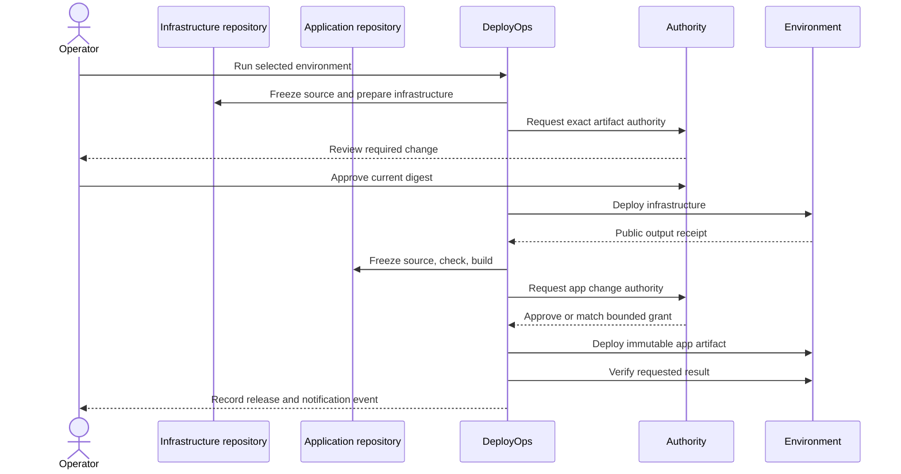

# Workflows

## Separate infrastructure and application delivery



This sequence runs locally. The cloud IaC path uses the separate gate workflow. Never combine cloud planning, arbitrary source builds, and writer credentials in one job.

## Review and delegation

`deploy-ops run development` pauses at an exact request. Approve its digest, then resume. A changed artifact, source snapshot, target policy, or workspace can't reuse that approval.

```bash
deploy-ops delegate development --hours 2 --uses 2
deploy-ops run development
```

The local command gives each component its own allowance. By default only known non-production local directory and static changes qualify, and unknown operations still wait. Use the gate's operator command for remote grants. There is no global approve-everything mode.

## Promote without rebuilding

```bash
deploy-ops run staging --component foundation
# Approve and resume that infrastructure release first.
deploy-ops promote SOURCE_RELEASE_ID staging --component web
# Review the staging request, then approve and resume it.
```

`promote_from` defines allowed environment transitions. Promotion reuses the source release's successful artifact and records its origin. The workspace contract must still match, and the destination's dependency receipt must exist. Infrastructure is never cloned across clouds.

To restore a previously successful artifact within the same environment:

```bash
deploy-ops rollback PREVIOUS_RELEASE_ID development --component web
```

Rollback creates a new reviewed release. It isn't an inverse infrastructure plan or a database restore, so schema migrations and external side effects need their own recovery plan.

## Interrupted work

Cancel a waiting release with `deploy-ops cancel RELEASE_ID`. Cancelling a running command requests termination, but provider activity may continue, so the target stays uncertain and blocked. Stop the worker, inspect the target, and reconcile:

```bash
deploy-ops recover RELEASE_ID --note "Inspected the target. Recorded the provider revision and confirmed its state."
```

Don't reuse that sentence as evidence without inspecting the target. Start a fresh release after reconciliation. The tool never guesses that a failed command had no effects. If controller inspection already resolved the request as failed while delivery still shows waiting, cancel the release to close that tracking record. Cancellation preserves the controller's final decision.

The console's release inspector shows command outcomes in execution order. The same records are
available through `deploy-ops events RELEASE_ID`: tool, component, local exit code when known, and
elapsed milliseconds. An interrupted command has no confirmed exit code at the interruption point;
inspect its target before retrying. A `not-started` result means the local process could not launch.
Older records show duration unavailable. These process results do not establish provider health or rollback.

For Container Apps, `deploy-ops provider inspect RELEASE_ID COMPONENT` reads the exact app and revision recorded before its update and checks the immutable image, container, template hash, health, and Single-mode activation without replaying the update. A missing or unreadable revision stays unknown, and readback doesn't clear release uncertainty. Same-image delivery makes no update call and verifies the existing revision. Missing evidence for a nondefault setting is refused ([scaling defaults](https://learn.microsoft.com/en-us/azure/container-apps/scale-app), [ephemeral storage](https://learn.microsoft.com/en-us/azure/container-apps/storage-mounts)).

The adapter uses a release-specific revision suffix, and Azure rejects conflicting suffixes, but that isn't an idempotency guarantee. The read and write aren't atomic, so an external concurrent change can still race the update. DeployOps never repeats the update command after recording an attempt. Recovery and no-op behavior have command-fixture coverage only, not a live recovery exercise.

## Inspect command output failures

Local delivery commands share a 10 MB raw-byte budget across stdout and private diagnostics. The runner
checks actual private-file extents while a child runs and again after it exits. An exit code of zero
can still have an unusable result when that combined output exceeds the policy. Inspect the recorded
command outcome and target before retrying: the command may already have changed files or a provider.
No automatic replay or rollback follows an output-policy failure.

CLI status/events and console release details retain the failure and observed exit code separately.
Private diagnostics stay out of ordinary events. Successful captured machine output keeps its existing
replacement decoding, while raw bytes determine the budget. Displayed stdout is redacted before its
bounded tail is selected. This observation limit does not reserve disk capacity or prevent every
between-check output burst.

## Notify and page

Entering approval wait records one event with the exact component/request ID and digest. Repeated
bounded waits or resume observations of that same pending request still recheck authority, but do
not create another decision-needed event or notification obligation. A new pending component/request
gets its own event. Worker start/stop evidence remains separate. If cancellation settles while an
already-waiting CLI sleeps, the waiter reports the cancelled record without execution. A direct
resume of a terminal release still refuses.

Events are saved before delivery. Send the outbox from a trusted scheduled worker or after a run:

```bash
export DEPLOY_OPS_NOTIFY_URL='https://your-approved-receiver.example/events'
deploy-ops notify
```

Use `--kind slack` for an incoming Slack webhook or `--kind ntfy` for a topic endpoint. JSON webhooks can be signed with `DEPLOY_OPS_NOTIFY_SECRET`, and `DEPLOY_OPS_NOTIFY_TOKEN` adds receiver authentication. Receivers should deduplicate the `Idempotency-Key`. Delivery is at least once with at most ten attempts, retried on another flush. Payloads hold release IDs and event names, not source, tokens, or plans. Paging and on-call schedules belong to an external system until a tested adapter exists.

## Observe local drift

```bash
deploy-ops observe RELEASE_ID
```

The console offers **Inspect deployed files** in release detail. The result has observation time, findings, and expected and observed digests, and records an audit event without changing files, approvals, or the release outcome. Static observations compare retained files with the current activation pointer. A later activation shows as `superseded`, and older corruption still reports `drifted`. Directory observations compare only `resource.json`.

`matching` means the inspected files matched at that time. `drifted` means missing or different recorded data. `unknown` means evidence is unreadable, unsafe, changing, or blocked by unresolved local execution. Other adapters report `unsupported`. File permissions, empty-directory changes, application health, cloud state, and container runtimes are out of scope.

Nothing is repaired automatically. Inspect a drifted or unknown target, then prepare a new exact change. A matching observation isn't a snapshot or protection against a malicious process running as the same OS user.
