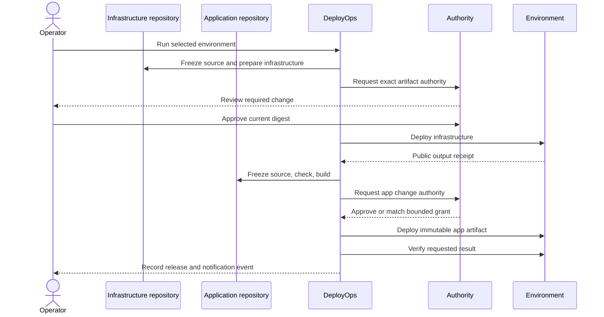

# Workflows

## Separate infrastructure and application delivery



This complete sequence is exercised locally. The cloud IaC path currently uses the separate gate workflow.
Do not collapse cloud planning, arbitrary source builds, and writer credentials into one job.

## Review and delegation

`deploy-ops run development` pauses at an exact request. Approve its displayed digest, then resume.
A changed artifact, source snapshot, target policy, or workspace cannot reuse that approval.

```bash
deploy-ops delegate development --hours 2 --uses 2
deploy-ops run development
```

The local command grants each component a separate allowance. Only known non-production local directory
and static changes qualify by default. Unknown operations still wait. Use the gate's operator command to
manage remote grants for specific targets. There is no global "approve everything" mode.

A grant can stop new claims and supervised local processes. It cannot unissue a bearer cloud token,
undo an accepted provider request, or guarantee a hard spending ceiling. See [security](../SECURITY.md).

## Promote without rebuilding

```bash
deploy-ops run staging --component foundation
# Approve and resume that infrastructure release first.
deploy-ops promote SOURCE_RELEASE_ID staging --component web
# Review the staging request, then approve and resume it.
```

`promote_from` defines allowed environment transitions. Promotion uses the source release's successful
artifact and records its origin. The workspace contract must still match. The destination's dependency
receipt must exist. Infrastructure is not silently cloned across clouds.

To restore a previously successful artifact within the same environment:

```bash
deploy-ops rollback PREVIOUS_RELEASE_ID development --component web
```

Rollback creates a new reviewed release. It is not an inverse infrastructure plan or a database restore.
Schema migrations and external side effects require a separate recovery plan.

## Interrupted work

Cancel a waiting release with `deploy-ops cancel RELEASE_ID`. Cancellation during a running command
requests termination, but provider-side activity may continue. The target stays uncertain and blocked.
Stop the worker, inspect the actual target, and reconcile it explicitly:

```bash
deploy-ops recover RELEASE_ID --note "Inspected the target. Recorded the provider revision and confirmed its state."
```

Do not reuse that sentence as evidence without actually inspecting the target. Start a fresh release after
reconciliation. The tool never guesses that a failed command had no effects.

## Notify and page

Events are saved before notification delivery. Send the outbox from a trusted scheduled worker or after a run:

```bash
export DEPLOY_OPS_NOTIFY_URL='https://your-approved-receiver.example/events'
deploy-ops notify
```

Use `--kind slack` for an incoming Slack webhook or `--kind ntfy` for a topic endpoint. JSON webhooks can
be signed with `DEPLOY_OPS_NOTIFY_SECRET`. Optional receiver authentication uses `DEPLOY_OPS_NOTIFY_TOKEN`.
Receivers should deduplicate the `Idempotency-Key`. Delivery is at least once with at most ten attempts.
Retries are triggered by another flush, not an undisclosed daemon.

Keep event payloads small. They contain release IDs and event names, not source code, cloud tokens, or
raw plans. Slack interactive approvals remain in the separate authority service. Paging escalation and
on-call schedules belong to an external incident system until a tested adapter is added.
